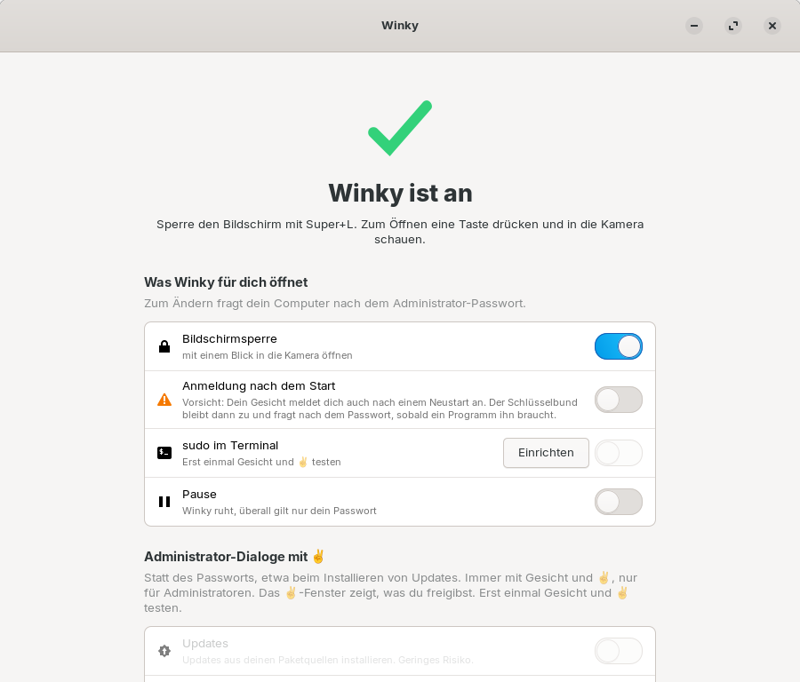
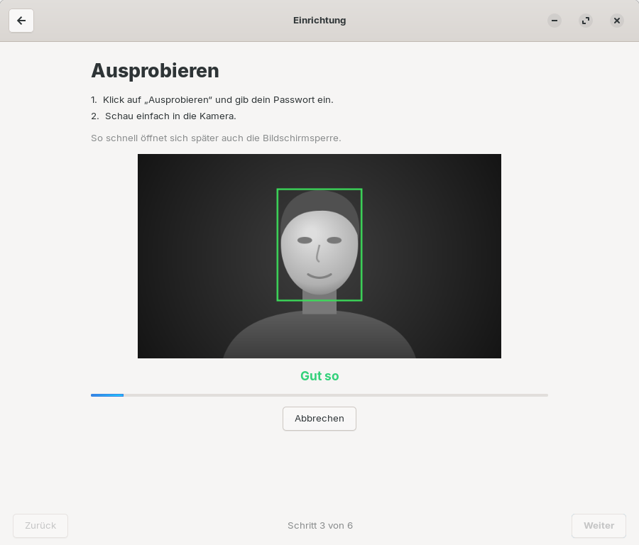

#  Winky

**Deutsch** · [English](README.md)

Winky öffnet die Bildschirmsperre von Linux mit einem Blick in die Infrarot-Kamera, ähnlich
wie Windows Hello. Wer möchte, bestätigt außerdem `sudo` im Terminal mit Gesicht und dem
Handzeichen ✌, statt das Passwort zu tippen. Eine App führt Schritt für Schritt durch die
Einrichtung.

Warum „Winky“: Bestätigen sollte man ursprünglich mit einem Zwinkern (englisch *wink*). In
den Tests war Zwinkern aber zu personenabhängig, das ✌ (Victory-Zeichen) wurde dagegen
zuverlässig erkannt. Geblieben sind das ✌ und der Name.



## Was Winky kann

- **Bildschirmsperre mit dem Gesicht öffnen.** Super+L sperrt, zum Öffnen eine Taste drücken
  und in die Kamera schauen. Typisch dauert das unter einer Sekunde.
- **sudo mit Gesicht und ✌ bestätigen** (freiwillig): Im Terminal erscheint
  `Winky: zum Bestätigen ✌ in die Kamera zeigen (sonst Passwort) …`. Bestätigt ist erst,
  wenn dein Gesicht erkannt ist **und** du daneben das V-Zeichen zeigst. Oben in der
  Bildschirmmitte erscheint dabei ein Hinweisfenster mit großem ✌ und dem Befehl.
- **KeePassXC öffnen** (freiwillig, **nur ab KeePassXC 2.8**): nach dem ersten Öffnen mit
  dem Master-Passwort, standardmäßig nur mit Gesicht **und** ✌.
- **Anmeldung nach dem Start mit dem Gesicht** (freiwillig): Der Schlüsselbund bleibt dann
  zu und fragt nach dem Passwort, sobald ein Programm ihn braucht.
- **Administrator-Dialoge mit Gesicht und ✌** (freiwillig): etwa
  Updates installieren, ohne das Passwort zu tippen.
- **Entsperren nur mit ✌** (freiwillig): Dann öffnet dein Gesicht allein weder die
  Bildschirmsperre noch die Anmeldung nach dem Start, du zeigst zusätzlich ✌. Wer dir den
  Rechner vors Gesicht hält, kommt so nicht hinein. Ohne ✌ erscheint das Passwortfeld nach
  höchstens 8 Sekunden.
- **Gesicht ergänzen** (freiwillig): Erkennt Winky dich manchmal nicht, etwa mit Brille oder
  bei anderem Licht, nimmst du diesen Anblick als benannte Ergänzung dazu. Höchstens drei,
  jede lässt sich wieder löschen. Übernommen wird nur, was zu deinem Gesicht passt.
- **Verlauf:** Im Nachhinein sehen, was Winky entsperrt und freigegeben hat, samt jedem
  sudo-Befehl und ob du ihn bestätigt hast. Praktisch, wenn ein KI-Assistent oder ein Skript
  für dich Befehle mit sudo ausführt.
- **Mehrere Personen** am selben Rechner, jede mit ihrem eigenen Gesicht und Passwort.
- **Einrichtung ohne Terminal:** Die App findet die Kamera, nimmt das Gesicht auf, lässt
  es ausprobieren und mit einer zweiten Person gegenprüfen. In der Software-Verwaltung
  lässt sich Winky wieder entfernen.
- **Ohne Netz und ohne Fotos:** Gespeichert werden nur Zahlen (Merkmalsvektoren), nur für
  das System lesbar.
- **Infrarot-Kamera nur für Winky** (freiwillig, unter Erweitert): Normalerweise kann jedes
  Programm unter deinem Konto die Kameras einschalten. Mit diesem Schalter darf nur Winky die
  Infrarot-Kamera benutzen; andere Programme, auch Schadprogramme, können sie nicht mehr
  öffnen. Andere Kameras bleiben, wie sie sind. Hängt die Infrarot-Kamera am selben Anschluss
  wie die normale Kamera, lässt Winky beide unverändert.

## Was Winky braucht

- Ubuntu 24.04 mit GNOME oder ein Abkömmling mit GNOME und dem Anmeldebildschirm GDM, etwa
  Zorin OS 18. 64-Bit-x86.
- Eine **Infrarot-Kamera**, wie sie für Windows Hello verbaut wird, mit funktionierendem
  Infrarot-Licht. Eine normale Webcam reicht nicht. Bleibt das Infrarot-Bild dunkel, hilft
  bei manchen Laptops [linux-enable-ir-emitter](https://github.com/EmixamPP/linux-enable-ir-emitter).
- Ein Administratorpasswort für die Einrichtung.

> **Bisher an zwei Laptops getestet:** Entwickelt und gemessen wurde Winky an einem Laptop
> mit Infrarot-Kamera (640 × 360, blinkendes Infrarot-Licht); es läuft außerdem auf einem
> **Microsoft Surface Laptop 4**. Andere Kameras können sich anders verhalten, etwa bei
> Helligkeit, Bildgröße oder Infrarot-Licht. Probier die Erkennung in der App aus, bevor du
> dich darauf verlässt, und mach die Prüfung mit einer zweiten Person.
- Etwa 2 Minuten für die Einrichtung und rund 75 MB Speicherplatz.
- Die App spricht Deutsch und Englisch, je nach Systemsprache.

## Was Winky nicht kann

- **Das Passwort ersetzen.** Nach dem Einschalten des Rechners (außer du schaltest es ein), bei su, SSH, der Konsole
  und in grafischen Administrator-Dialogen (außer du schaltest sie mit ✌ frei) gilt immer
  das Passwort. Das Passwort funktioniert außerdem immer als Ausweg.
- **Zwillinge oder sehr ähnliche Geschwister sicher unterscheiden.** Das kann kein
  Gesichtssystem.
- **Täuschung mit einem Infrarot-Ausdruck oder einer Maske sicher erkennen.** Winky hat
  keine echte Lebenderkennung. Fotos auf Bildschirmen und Handys funktionieren dagegen
  nicht, weil Bildschirme im Infrarot-Bild schwarz sind.
- **Gegen Diebstahl schützen.** Dafür braucht es eine verschlüsselte Festplatte.
- **Erkennen, ob du einverstanden bist.** Wer dir den Rechner vors Gesicht hält, öffnet die
  Sperre. Für sudo verlangt Winky deshalb zusätzlich das ✌; fürs Entsperren lässt sich
  „Entsperren nur mit ✌“ einschalten.
- Mit einer normalen Webcam, mit KDE, Xfce oder einem anderen Anmeldebildschirm als GDM
  arbeiten.

## Sicherheitsrisiken auf einen Blick

Ausführlich in **[SICHERHEIT.md](SICHERHEIT.md)**.

**In der Benutzung** (liegt bei dir):

- Ein nicht gesperrter Rechner ist offen. Winky schützt nur, was gesperrt ist.
- Sehr ähnliche Menschen im Haushalt können durchkommen. Mach die Prüfung mit einer
  zweiten Person und stell Winky im Zweifel strenger ein.
- Eine niedrigere Strenge ist bequemer, aber unsicherer.
- Zeig ✌ nur für Befehle, die du selbst gerade getippt hast. Eine unerwartete
  Winky-Meldung bedeutet: kein ✌.
- Schaltest du bei KeePassXC das ✌ ab, öffnet dein Gesicht allein deine Passwort-Datenbank.
- Die Gesichtsdaten landen in Systemsicherungen, wenn diese `/var/lib` sichern.

**In der Technik** (lässt sich nicht abstellen):

- Keine Lebenderkennung: Ein im Infrarot sichtbarer Ausdruck oder eine Maske wurden nicht
  getestet und könnten durchkommen.
- Die Zuverlässigkeit wurde an einem Laptop mit der eigenen und einer weiteren Person
  gemessen (an einem zweiten Laptop ausprobiert), nicht statistisch belegt.
- Neuer Code läuft in der Anmeldung mit (klein gehalten, mit Freigabeliste und Zeitlimit).
- Wer den abgeschotteten Prüfdienst übernimmt oder eine Kamera-Attrappe einbaut, kann
  entsperren.
- Ein Schadprogramm unter deinem Konto kann sudo-Anfragen auslösen. Ohne dein ✌ passiert
  nichts, aber ein ✌ im falschen Moment könnte einer fremden Anfrage gelten.
- Die mitgelieferte Erkennungslaufzeit bekommt Korrekturen nur mit neuen Winky-Versionen.
- Winky ist nicht unabhängig geprüft.

## Installation

Die Datei `winky_<version>_amd64.deb` von der
[Release-Seite](https://github.com/DieSchatten/winky/releases/latest) herunterladen und doppelt
anklicken. Die Software-Verwaltung installiert sie nach dem Administratorpasswort. Oder im
Terminal:

```bash
sudo apt install ./winky_*_amd64.deb
```

Die Prüfsumme steht auf der Release-Seite (`sha256sum winky_*_amd64.deb`). Das Paket
richtet zugleich Winkys eigene Paketquelle ein. Danach kommen Updates wie alle anderen über
die Software-Verwaltung, und die Suche nach „Winky“ oder „Windows Hello“ findet es dort.
Einstellungen und Gesichtsdaten bleiben erhalten.

Oder nur die Paketquelle einrichten und daraus installieren:

```bash
sudo wget -O /usr/share/keyrings/winky-archive-keyring.gpg https://dieschatten.github.io/winky/winky-archive-keyring.gpg
sudo wget -O /etc/apt/sources.list.d/winky.sources https://dieschatten.github.io/winky/winky.sources
sudo apt update && sudo apt install winky
```

Die Paketquelle ist mit dem Schlüssel `AC60 2CDB 8464 31CF 6787  2100 A0B2 C5BB 34E5 B149`
unterschrieben. Beim Deinstallieren von Winky verschwindet auch die Paketquelle.

Selbst bauen (braucht Podman, alles läuft im Container, das Paket landet in `bau/`):

```bash
./scripts/paket-bauen.sh
```

Nach der Installation ist nichts aktiv. Die App **Winky** im Anwendungsmenü führt durch die
Einrichtung:

1. **Kamera finden:** sucht die Infrarot-Kamera (Administratorpasswort).
2. **Gesicht aufnehmen:** 25 Sekunden, Kopf langsam etwas bewegen (eigenes Passwort).
3. **Ausprobieren.**
4. **Mit einer zweiten Person prüfen** (freiwillig, empfohlen): Winky darf sie nicht
   erkennen. Ist sie zu ähnlich, stellt ein Knopf Winky strenger ein.
5. **Einschalten** (Administratorpasswort).
6. **Für das Terminal** (freiwillig): Gesicht und ✌ testen, dann sudo damit bestätigen
   lassen.

Danach zeigt die Übersicht den Zustand mit „Ausprobieren“ und „Pause“; die Schalter
(Bildschirmsperre, sudo im Terminal, KeePassXC …) liegen unter „Freigaben“. Technisches wie Kamera, Strenge und Version steht unter „Erweitert“.



## sudo mit Gesicht und ✌

```
$ sudo apt update
Winky: zum Bestätigen ✌ in die Kamera zeigen (sonst Passwort) …
Winky: ✓ bestätigt
```

- Das V-Zeichen: Zeige- und Mittelfinger hoch, Handfläche zur Kamera, neben dem Gesicht,
  etwa eine halbe Sekunde halten.
- Nur sudo in einem Terminal der laufenden Sitzung am Rechner selbst. Nicht über SSH, nicht
  ohne Terminal, nicht mit `sudo -S`.
- Genau ein Gesicht im Bild, die Hand nah daneben, und es muss das erkannte Gesicht sein.
- ✌ verpasst? Enter ohne Passwort drücken: sudo fragt neu, und Winky wartet noch einmal
  auf das ✌.
- Zwei Anfragen zur selben Zeit werden beide abgebrochen. Nach drei unbestätigten gilt
  zehn Minuten lang nur das Passwort.
- Sonst kommt nach der Zeit für das ✌ (Vorgabe 8 Sekunden, unter Erweitert bis 30
  einstellbar) die gewohnte Passwortabfrage. Das ✌-Fenster zeigt, was du freigibst.

Warum ✌: Gemessen wurden auch Zwinkern, „Daumen hoch“ und „Nase antippen“. Zwinkern war zu
personenabhängig, die beiden anderen Zeichen findet die Handerkennung im Infrarot-Bild nicht
zuverlässig. Das ✌ wurde in 11 von 12 Versuchen erkannt, auch im Dunkeln und mit etwa
70 cm Abstand, im Mittel nach einer Sekunde ab der Aufforderung samt Hand heben. Beim Tippen
und im Alltag, auch beim Zählen mit den Fingern, kam es nie in die Nähe der Erkennungsgrenze.

## KeePassXC (ab 2.8)

**Funktioniert erst ab KeePassXC 2.8 als normales Paket.** Ältere Versionen haben unter
Linux kein Schnellentsperren, und die Flatpak-Version kann es nicht am System anmelden; dort
fragt KeePassXC wie gewohnt nach dem Master-Passwort. Die App zeigt das deutlich an, solange
kein passendes KeePassXC gefunden wird.

KeePassXC 2.8 bringt unter Linux ein Schnellentsperren über Polkit mit. Mit dem Schalter
**KeePassXC** gilt dort zuerst Winky:

- **Standardmäßig Gesicht und ✌**, wie bei sudo: Ein Hinweisfenster mit großem ✌ fordert
  dazu auf.
  Ohne dein Handzeichen öffnet niemand die Datenbank, auch nicht, während du vor dem
  Rechner sitzt. Mit dem Schalter **KeePassXC nur mit ✌** lässt sich das abschalten, dann
  genügt das Gesicht.
- Eine Polkit-Regel (`/etc/polkit-1/rules.d/50-winky-keepassxc.rules`) greift nur für die
  Aktion `org.keepassxc.KeePassXC.unlockDatabase` und nur in einer aktiven lokalen Sitzung.
- Erkannt heißt: kein Passwortdialog. Sonst erscheint wie gewohnt der Dialog. Alle anderen
  Polkit-Abfragen bleiben unberührt.
- Den Schlüssel für das Schnellentsperren hält KeePassXC nur im laufenden Programm. Nach
  jedem Neustart von KeePassXC gilt wieder das Master-Passwort.
- Getestet mit KeePassXC 2.8.0 Beta 1 (AppImage, Polkit-Aktion von Hand installiert).

## Administrator-Dialoge mit ✌

Mit **Administrator-Dialoge** unter „Freigaben“ lassen sich Passwortdialoge, die nach dem
Administratorpasswort fragen (etwa beim Installieren von Updates, Software oder bei
`pkexec`), stattdessen mit Gesicht und ✌ freigeben. Ab Werk aus.

- Winky arbeitet im Passwortdialog selbst (PAM-Dienst `polkit-1`), wie die
  Fingerabdruck-Anmeldung von GNOME. Es wird nur aktiv, wenn wirklich ein Dialog auf dem
  Bildschirm erscheint; Berechtigungsabfragen von Programmen im Hintergrund erreichen Winky nie.
- Der Dialog zeigt, was du freigibst; Winky schreibt „✌ zeigen …“ hinein, und das große
  ✌-Fenster erscheint. Ohne ✌ fragt derselbe Dialog nach der eingestellten ✌-Zeit nach dem
  Passwort.
- Immer Gesicht **und** ✌, nur für das Konto, nach dem der Dialog fragt, nur in einer aktiven,
  lokalen Sitzung. Die Pause schaltet auch das ab.

## Anmeldung nach dem Start und Schlüsselbund (experimentell)

Mit **Anmeldung nach dem Start** unter „Freigaben“ meldet dich dein Gesicht auch nach einem
Neustart an. Der Schlüsselbund (gespeicherte Passwörter von Browser, WLAN, Mail) bleibt dann
normalerweise zu, weil ihn nur dein Passwort öffnet.

**Auch den Schlüsselbund entsperren (experimentell)** löst das wie Windows Hello: Du gibst
dein Anmeldepasswort einmal in der App ein, Winky prüft es und speichert es versiegelt im
TPM-Chip des Rechners (`systemd-creds`, gebunden an diese Installation und den
Secure-Boot-Zustand). Nach einer Gesichtsanmeldung gibt ein kleiner, abgeschotteter Dienst es
an den Schlüsselbund weiter, nur direkt nachdem die Anmeldemaske dein Gesicht erkannt hat und
nur nach einer Prüfung, ob es noch stimmt. Änderst du dein Passwort, verwirft Winky die
versiegelte Kopie, und die App bittet dich, es neu einzurichten.

**Risiko:** Dein Anmeldepasswort ist dann auf diesem Rechner wiederherstellbar. Ohne Secure
Boot schützt der TPM-Chip es nur schwach; wer den Rechner hat, kann es unter Umständen
auslesen. Nutze das nur mit einem Passwort, das du nirgends sonst verwendest, am besten mit
Secure Boot und verschlüsselter Festplatte.

## Notfall und Deinstallieren

Schnellster Weg zuerst:

1. In der App den Schalter **Pause** einschalten.
2. Ohne App, auch über Strg+Alt+F3 nach Anmeldung mit Passwort:

   ```bash
   sudo touch /etc/winky/disabled
   ```

3. Ganz ausschalten:

   ```bash
   sudo pam-auth-update --disable winky
   ```

4. Deinstallieren, in der Software-Verwaltung unter **Installiert** oder im Terminal. Das
   stellt die Anmeldung zurück und löscht die Gesichtsdaten aller Benutzer:

   ```bash
   sudo apt purge winky
   ```

Vor jedem Einschalten legt Winky eine Sicherung von `/etc/pam.d/common-auth` unter
`/var/lib/winky/sicherung/` an.

## Nutzung auf eigenes Risiko

Die Nutzung von Winky erfolgt auf eigenes Risiko. Winky ist ein Komfortmerkmal und ersetzt
weder ein starkes Passwort noch eine verschlüsselte Festplatte. Welche Risiken bekannt sind,
steht in [SICHERHEIT.md](SICHERHEIT.md).

Winky wird so bereitgestellt, wie es ist; Pflege und Korrekturen sind nicht zugesagt. Fehler
und Fragen gern als [Issue](https://github.com/DieSchatten/winky/issues). Nach der
MIT-Lizenz darf jeder Winky selbst weiterentwickeln.

## Herkunft und Lizenz

Winky ist eine eigenständige Entwicklung unter der MIT-Lizenz ([LICENSE](LICENSE)).
Mitgeliefert werden freie Modelle: YuNet für die Gesichtssuche (MIT), SFace für den
Gesichtsvergleich (Apache-2.0), beide aus dem [OpenCV Zoo](https://github.com/opencv/opencv_zoo),
und der MediaPipe Gesture Recognizer von Google (Apache-2.0) für das ✌. Dazu ONNX Runtime
(MIT). Einzelheiten in [NOTICE](NOTICE).

Bauen, Aufbau, Tests und Messergebnisse: [ENTWICKLUNG.md](ENTWICKLUNG.md).
Änderungen je Version: [CHANGELOG.md](CHANGELOG.md).
