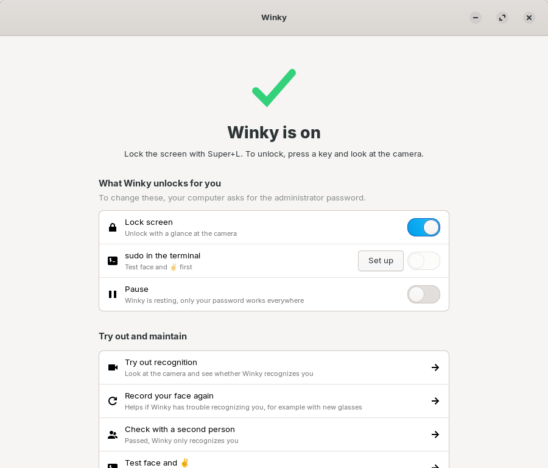
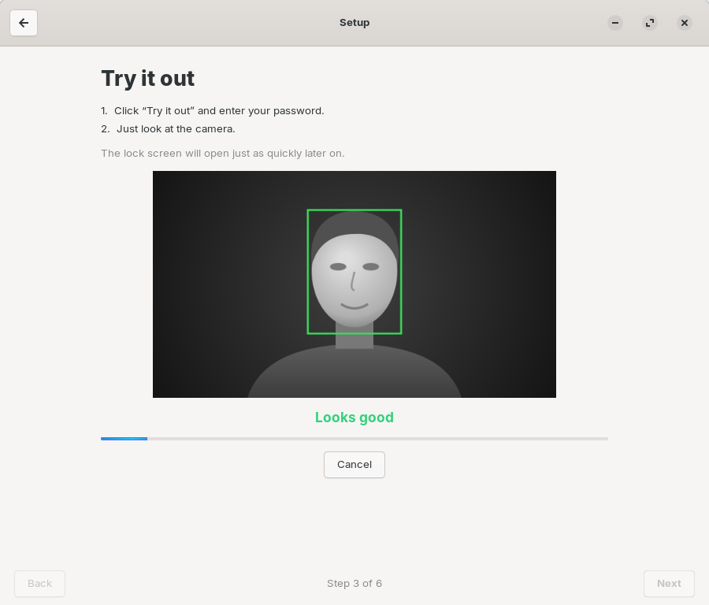

#  Winky

**English** · [Deutsch](README.de.md)

Winky unlocks the Linux lock screen with a glance into the infrared camera, similar to
Windows Hello. If you like, you can also confirm `sudo` in the terminal with your face and
the ✌ sign instead of typing your password. An app guides you through the setup step by
step.



## What Winky can do

- **Unlock the lock screen with your face.** Super+L locks; to unlock, press a key and look
  into the camera. This typically takes less than a second.
- **Confirm sudo with your face and ✌** (optional): The terminal shows
  `Winky: show ✌ to the camera to confirm (or type your password) …`. It only counts as
  confirmed when your face is recognized **and** you show the V sign next to it. A notice
  window with a large ✌ and the command appears at the top center of the screen.
- **Open KeePassXC** (optional, **KeePassXC 2.8 or later only**): after the first unlock
  with the master password, by default only with your face **and** ✌.
- **Several people** on the same computer, each with their own face and password.
- **Setup without the terminal:** The app finds the camera, records your face, lets you try
  it out and check it with a second person. Winky can be removed again in the software
  manager.
- **No network and no photos:** Only numbers (feature vectors) are stored, readable only by
  the system.

## What Winky needs

- Ubuntu 24.04 with GNOME, or a derivative with GNOME and the GDM login screen, such as
  Zorin OS 18. 64-bit x86.
- An **infrared camera** of the kind built in for Windows Hello, with working infrared
  light. A normal webcam is not enough. If the infrared image stays dark,
  [linux-enable-ir-emitter](https://github.com/EmixamPP/linux-enable-ir-emitter) helps on
  some laptops.
- An administrator password for the setup.

> **Only tested with one infrared camera so far:** Winky was developed and measured on a
> laptop with one infrared camera (640 × 360, blinking infrared light). Other cameras may
> behave differently, for example in brightness, image size or infrared light. Try out the
> recognition in the app before you rely on it, and do the check with a second person.
- About 2 minutes for the setup and around 75 MB of disk space.
- The app speaks English and German, depending on the system language.

## What Winky cannot do

- **Replace your password.** After switching on the computer, for su, SSH, the console and
  in graphical administrator dialogs, the password always applies. The password also always
  works as a way out.
- **Reliably tell twins or very similar siblings apart.** No face recognition system can do
  that.
- **Reliably detect spoofing with an infrared printout or a mask.** Winky has no real
  liveness detection. Photos on screens and phones, on the other hand, do not work, because
  screens are black in the infrared image.
- **Protect against theft.** That requires an encrypted disk.
- **Tell whether you agree.** Anyone who holds the computer up to your face opens the lock
  screen. That is why Winky additionally requires the ✌ for sudo.
- Work with a normal webcam, with KDE, Xfce or a login screen other than GDM.

## Security risks at a glance

Details in **[SECURITY.md](SECURITY.md)**.

**In use** (up to you):

- A computer that is not locked is open. Winky only protects what is locked.
- Very similar people in your household may get through. Do the check with a second person
  and, if in doubt, make Winky stricter.
- A lower strictness is more convenient, but less secure.
- Only show ✌ for commands you have just typed yourself. An unexpected Winky message means:
  no ✌.
- If you turn off the ✌ for KeePassXC, your face alone opens your password database.
- The face data ends up in system backups if they back up `/var/lib`.

**In the technology** (cannot be switched off):

- No liveness detection: a printout that is visible in infrared, or a mask, has not been
  tested and might get through.
- Reliability was measured on one laptop, with the current recognition model so far only
  with one person; it is not statistically proven.
- New code runs as part of the login (kept small, with an allow list and a time limit).
- Anyone who takes over the isolated verification service or installs a fake camera can
  unlock.
- Malware running under your account can trigger sudo requests. Without your ✌ nothing
  happens, but a ✌ at the wrong moment could apply to someone else's request.
- The bundled recognition runtime only gets fixes with new Winky versions.
- Winky has not been independently reviewed.

## Installation

Download the file `winky_<version>_amd64.deb` from the
[releases page](https://github.com/DieSchatten/winky/releases) and double-click it. The
software manager installs it after you enter the administrator password. Or in the
terminal:

```bash
sudo apt install ./winky_0.9.0_amd64.deb
```

The checksum is on the releases page (`sha256sum winky_0.9.0_amd64.deb`). The package also
sets up Winky's own package source. From then on, updates arrive through the software manager
like any other update, and searching for "Winky" or "Windows Hello" there finds it. Your
settings and face data are kept.

Alternatively, set up only the package source and install from it:

```bash
sudo wget -O /usr/share/keyrings/winky-archive-keyring.gpg https://dieschatten.github.io/winky/winky-archive-keyring.gpg
sudo wget -O /etc/apt/sources.list.d/winky.sources https://dieschatten.github.io/winky/winky.sources
sudo apt update && sudo apt install winky
```

The package source is signed with the key `AC60 2CDB 8464 31CF 6787  2100 A0B2 C5BB 34E5 B149`.
Uninstalling Winky also removes the package source.

Build it yourself (needs Podman, everything runs in a container, the package ends up in
`bau/`):

```bash
./scripts/paket-bauen.sh
```

After installation, nothing is active. The **Winky** app in the applications menu guides you
through the setup:

1. **Find the camera:** looks for the infrared camera (administrator password).
2. **Record your face:** 25 seconds, slowly move your head a little (your own password).
3. **Try it out.**
4. **Check with a second person** (optional, recommended): Winky must not recognize them. If
   they are too similar, a button makes Winky stricter.
5. **Turn on** (administrator password).
6. **For the terminal** (optional): test your face and ✌, then let sudo be confirmed with
   them.

After that, the home page only shows switches: lock screen, sudo in the terminal, KeePassXC
and Pause. Technical details such as camera, strictness and version are under “Advanced”.



## sudo with face and ✌

```
$ sudo apt update
Winky: show ✌ to the camera to confirm (or type your password) …
Winky: ✓ confirmed
```

- The V sign: index and middle finger up, palm towards the camera, next to your face, hold
  it for about half a second.
- Only sudo in a terminal of the running session at the computer itself. Not over SSH, not
  without a terminal, not with `sudo -S`.
- Exactly one face in the picture, the hand close beside it, and it must be the recognized
  face.
- Two requests at the same time are both cancelled. After three unconfirmed requests, only
  the password works for ten minutes.
- Otherwise, the usual password prompt appears after about eight seconds.

Why ✌: Winking, “thumbs up” and “touching your nose” were also measured. Winking depended
too much on the person; the hand recognition does not reliably find the other two signs in
the infrared image. The ✌ was recognized in 11 of 12 attempts, also in the dark and at a
distance of about 70 cm, on average after one second from the prompt, including raising the
hand. While typing and in everyday use, even when counting on fingers, it never came close
to the recognition threshold.

## KeePassXC (2.8 or later)

**Only works with KeePassXC 2.8 or later as a regular package.** Older versions have no
quick unlock on Linux, and the Flatpak version cannot register it with the system; there,
KeePassXC asks for the master password as usual. The app shows this clearly as long as no
suitable KeePassXC is found.

KeePassXC 2.8 brings a quick unlock via Polkit on Linux. With the **KeePassXC** switch,
Winky is asked first:

- **By default face and ✌**, as with sudo: a notice window with a large ✌ asks you to show
  it.
  Without your ✌ sign, nobody opens the database, not even while you are sitting in front of
  the computer. The **KeePassXC only with ✌** switch turns this off; then your face is
  enough.
- A Polkit rule (`/etc/polkit-1/rules.d/50-winky-keepassxc.rules`) applies only to the
  action `org.keepassxc.KeePassXC.unlockDatabase` and only in an active local session.
- Recognized means: no password dialog. Otherwise the dialog appears as usual. All other
  Polkit requests are not affected.
- KeePassXC keeps the key for quick unlock only in the running program. After every restart
  of KeePassXC, the master password applies again.
- Tested with KeePassXC 2.8.0 Beta 1 (AppImage, Polkit action installed by hand).

## Emergency and uninstalling

Fastest way first:

1. In the app, turn on the **Pause** switch.
2. Without the app, also via Ctrl+Alt+F3 after logging in with your password:

   ```bash
   sudo touch /etc/winky/disabled
   ```

3. Turn it off completely:

   ```bash
   sudo pam-auth-update --disable winky
   ```

4. Uninstall, in the software manager under **Installed** or in the terminal. This restores
   the login and deletes the face data of all users:

   ```bash
   sudo apt purge winky
   ```

Each time before it is turned on, Winky saves a backup of `/etc/pam.d/common-auth` under
`/var/lib/winky/sicherung/`.

## Use at your own risk

You use Winky at your own risk. Winky is a convenience feature and replaces neither a strong
password nor an encrypted disk. The known risks are described in [SECURITY.md](SECURITY.md).

Winky is provided as is; maintenance and fixes are not promised. Bug reports and questions
are welcome as an [issue](https://github.com/DieSchatten/winky/issues). Under the MIT
license, anyone may develop Winky further themselves.

## Origin and license

Winky is an independent development under the MIT license ([LICENSE](LICENSE)). It ships
with free models: YuNet for face detection (MIT), SFace for face comparison (Apache-2.0),
both from the [OpenCV Zoo](https://github.com/opencv/opencv_zoo), and Google's MediaPipe
Gesture Recognizer (Apache-2.0) for the ✌. Plus ONNX Runtime (MIT). Details in
[NOTICE](NOTICE).

Building, architecture, tests and measurement tools:
[developer notes (German)](ENTWICKLUNG.md).
Changes per version: [CHANGELOG.md](CHANGELOG.md).
