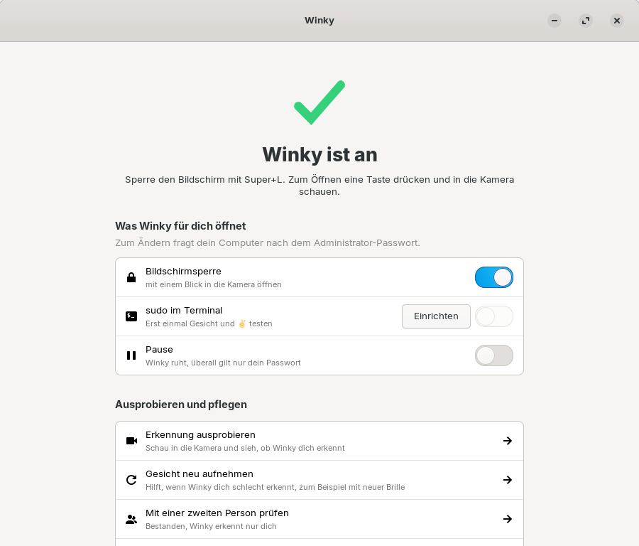
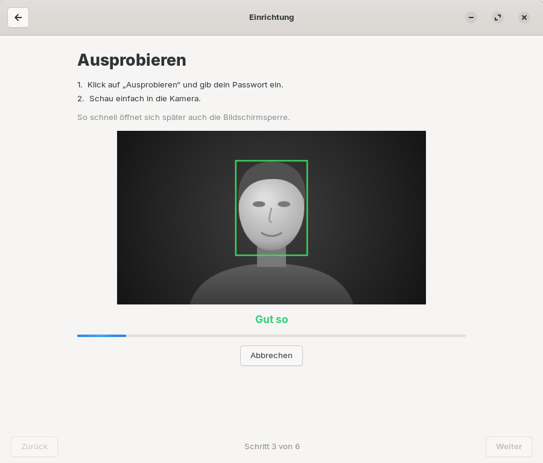

#  Winky

Winky öffnet die Bildschirmsperre von Linux mit einem Blick in die Infrarot-Kamera, ähnlich
wie Windows Hello. Wer möchte, bestätigt außerdem `sudo` im Terminal mit Gesicht und dem
Handzeichen ✌, statt das Passwort zu tippen. Eine App führt Schritt für Schritt durch die
Einrichtung.



## Was Winky kann

- **Bildschirmsperre mit dem Gesicht öffnen.** Super+L sperrt, zum Öffnen eine Taste drücken
  und in die Kamera schauen. Typisch dauert das unter einer Sekunde.
- **sudo mit Gesicht und ✌ bestätigen** (freiwillig): Im Terminal erscheint
  `Winky: zum Bestätigen ✌ in die Kamera zeigen (sonst Passwort) …`. Bestätigt ist erst,
  wenn dein Gesicht erkannt ist **und** du daneben das V-Zeichen zeigst. Oben in der
  Bildschirmmitte erscheint dabei ein Hinweisfenster mit großem ✌ und dem Befehl.
- **KeePassXC öffnen** (freiwillig, **nur ab KeePassXC 2.8**): nach dem ersten Öffnen mit
  dem Master-Passwort, standardmäßig nur mit Gesicht **und** ✌.
- **Mehrere Personen** am selben Rechner, jede mit ihrem eigenen Gesicht und Passwort.
- **Einrichtung ohne Terminal:** Die App findet die Kamera, nimmt das Gesicht auf, lässt
  es ausprobieren und mit einer zweiten Person gegenprüfen. In der Software-Verwaltung
  lässt sich Winky wieder entfernen.
- **Ohne Netz und ohne Fotos:** Gespeichert werden nur Zahlen (Merkmalsvektoren), nur für
  das System lesbar.

## Was Winky braucht

- Ubuntu 24.04 mit GNOME oder ein Abkömmling mit GNOME und dem Anmeldebildschirm GDM, etwa
  Zorin OS 18. 64-Bit-x86.
- Eine **Infrarot-Kamera**, wie sie für Windows Hello verbaut wird, mit funktionierendem
  Infrarot-Licht. Eine normale Webcam reicht nicht. Bleibt das Infrarot-Bild dunkel, hilft
  bei manchen Laptops [linux-enable-ir-emitter](https://github.com/EmixamPP/linux-enable-ir-emitter).
- Ein Administratorpasswort für die Einrichtung.

> **Bisher nur mit einer Kamera getestet:** Entwickelt und gemessen wurde Winky an einem
> Laptop mit einer Infrarot-Kamera (640 × 360, blinkendes Infrarot-Licht). Andere Kameras
> können sich anders verhalten, etwa bei Helligkeit, Bildgröße oder Infrarot-Licht. Probier
> die Erkennung in der App aus, bevor du dich darauf verlässt, und mach die Prüfung mit einer
> zweiten Person.
- Etwa 2 Minuten für die Einrichtung und rund 75 MB Speicherplatz.

## Was Winky nicht kann

- **Das Passwort ersetzen.** Nach dem Einschalten des Rechners, bei su, SSH, der Konsole
  und in grafischen Administrator-Dialogen gilt immer das Passwort. Das Passwort
  funktioniert außerdem immer als Ausweg.
- **Zwillinge oder sehr ähnliche Geschwister sicher unterscheiden.** Das kann kein
  Gesichtssystem.
- **Täuschung mit einem Infrarot-Ausdruck oder einer Maske sicher erkennen.** Winky hat
  keine echte Lebenderkennung. Fotos auf Bildschirmen und Handys funktionieren dagegen
  nicht, weil Bildschirme im Infrarot-Bild schwarz sind.
- **Gegen Diebstahl schützen.** Dafür braucht es eine verschlüsselte Festplatte.
- **Erkennen, ob du einverstanden bist.** Wer dir den Rechner vors Gesicht hält, öffnet die
  Sperre. Für sudo verlangt Winky deshalb zusätzlich das ✌.
- Mit einer normalen Webcam, mit KDE, Xfce oder einem anderen Anmeldebildschirm als GDM
  arbeiten.

## Sicherheitsrisiken auf einen Blick

Ausführlich in **[SICHERHEIT.md](SICHERHEIT.md)**.

**In der Benutzung** (liegt bei dir):

- Ein nicht gesperrter Rechner ist offen. Winky schützt nur, was gesperrt ist.
- Sehr ähnliche Menschen im Haushalt können durchkommen. Mach die Prüfung mit einer
  zweiten Person und stell Winky im Zweifel strenger ein.
- Eine niedrigere Strenge ist bequemer, aber unsicherer.
- Zeig ✌ nur für Befehle, die du selbst gerade getippt hast. Eine unerwartete
  Winky-Meldung bedeutet: kein ✌.
- Schaltest du bei KeePassXC das ✌ ab, öffnet dein Gesicht allein deine Passwort-Datenbank.
- Die Gesichtsdaten landen in Systemsicherungen, wenn diese `/var/lib` sichern.

**In der Technik** (lässt sich nicht abstellen):

- Keine Lebenderkennung: Ein im Infrarot sichtbarer Ausdruck oder eine Maske wurden nicht
  getestet und könnten durchkommen.
- Die Zuverlässigkeit wurde an einem Laptop gemessen, mit dem aktuellen Erkennungsmodell
  bisher nur mit einer Person, nicht statistisch belegt.
- Neuer Code läuft in der Anmeldung mit (klein gehalten, mit Freigabeliste und Zeitlimit).
- Wer den abgeschotteten Prüfdienst übernimmt oder eine Kamera-Attrappe einbaut, kann
  entsperren.
- Ein Schadprogramm unter deinem Konto kann sudo-Anfragen auslösen. Ohne dein ✌ passiert
  nichts, aber ein ✌ im falschen Moment könnte einer fremden Anfrage gelten.
- Die mitgelieferte Erkennungslaufzeit bekommt Korrekturen nur mit neuen Winky-Versionen.
- Winky ist nicht unabhängig geprüft.

## Installation

Die Datei `winky_<version>_amd64.deb` von der
[Release-Seite](https://github.com/DieSchatten/winky/releases) herunterladen und doppelt
anklicken. Die Software-Verwaltung installiert sie nach dem Administratorpasswort. Oder im
Terminal:

```bash
sudo apt install ./winky_0.8.1_amd64.deb
```

Die Prüfsumme steht auf der Release-Seite (`sha256sum winky_0.8.1_amd64.deb`). Eine neue
Version installiert man genauso; die Einstellungen und Gesichtsdaten bleiben erhalten.

Selbst bauen (braucht Podman, alles läuft im Container, das Paket landet in `bau/`):

```bash
./scripts/paket-bauen.sh
```

Nach der Installation ist nichts aktiv. Die App **Winky** im Anwendungsmenü führt durch die
Einrichtung:

1. **Kamera finden:** sucht die Infrarot-Kamera (Administratorpasswort).
2. **Gesicht aufnehmen:** 25 Sekunden, Kopf langsam etwas bewegen (eigenes Passwort).
3. **Ausprobieren.**
4. **Mit einer zweiten Person prüfen** (freiwillig, empfohlen): Winky darf sie nicht
   erkennen. Ist sie zu ähnlich, stellt ein Knopf Winky strenger ein.
5. **Einschalten** (Administratorpasswort).
6. **Für das Terminal** (freiwillig): Gesicht und ✌ testen, dann sudo damit bestätigen
   lassen.

Danach zeigt die Startseite nur noch Schalter: Bildschirmsperre, sudo im Terminal,
KeePassXC und Pause. Technisches wie Kamera, Strenge und Version steht unter „Erweitert“.



## sudo mit Gesicht und ✌

```
$ sudo apt update
Winky: zum Bestätigen ✌ in die Kamera zeigen (sonst Passwort) …
Winky: ✓ bestätigt
```

- Das V-Zeichen: Zeige- und Mittelfinger hoch, Handfläche zur Kamera, neben dem Gesicht,
  etwa eine halbe Sekunde halten.
- Nur sudo in einem Terminal der laufenden Sitzung am Rechner selbst. Nicht über SSH, nicht
  ohne Terminal, nicht mit `sudo -S`.
- Genau ein Gesicht im Bild, die Hand nah daneben, und es muss das erkannte Gesicht sein.
- Zwei Anfragen zur selben Zeit werden beide abgebrochen. Nach drei unbestätigten gilt
  zehn Minuten lang nur das Passwort.
- Sonst kommt nach etwa acht Sekunden die gewohnte Passwortabfrage.

Warum ✌: Gemessen wurden auch Zwinkern, „Daumen hoch“ und „Nase antippen“. Zwinkern war zu
personenabhängig, die beiden anderen Zeichen findet die Handerkennung im Infrarot-Bild nicht
zuverlässig. Das ✌ wurde in 11 von 12 Versuchen erkannt, auch im Dunkeln und mit etwa
70 cm Abstand, im Mittel nach einer Sekunde ab der Aufforderung samt Hand heben. Beim Tippen
und im Alltag, auch beim Zählen mit den Fingern, kam es nie in die Nähe der Erkennungsgrenze.

## KeePassXC (ab 2.8)

**Funktioniert erst ab KeePassXC 2.8 als normales Paket.** Ältere Versionen haben unter
Linux kein Schnellentsperren, und die Flatpak-Version kann es nicht am System anmelden; dort
fragt KeePassXC wie gewohnt nach dem Master-Passwort. Die App zeigt das deutlich an, solange
kein passendes KeePassXC gefunden wird.

KeePassXC 2.8 bringt unter Linux ein Schnellentsperren über Polkit mit. Mit dem Schalter
**KeePassXC** gilt dort zuerst Winky:

- **Standardmäßig Gesicht und ✌**, wie bei sudo: Ein Hinweisfenster mit großem ✌ fordert
  dazu auf.
  Ohne dein Handzeichen öffnet niemand die Datenbank, auch nicht, während du vor dem
  Rechner sitzt. Mit dem Schalter **KeePassXC nur mit ✌** lässt sich das abschalten, dann
  genügt das Gesicht.
- Eine Polkit-Regel (`/etc/polkit-1/rules.d/50-winky-keepassxc.rules`) greift nur für die
  Aktion `org.keepassxc.KeePassXC.unlockDatabase` und nur in einer aktiven lokalen Sitzung.
- Erkannt heißt: kein Passwortdialog. Sonst erscheint wie gewohnt der Dialog. Alle anderen
  Polkit-Abfragen bleiben unberührt.
- Den Schlüssel für das Schnellentsperren hält KeePassXC nur im laufenden Programm. Nach
  jedem Neustart von KeePassXC gilt wieder das Master-Passwort.
- Getestet mit KeePassXC 2.8.0 Beta 1 (AppImage, Polkit-Aktion von Hand installiert).

## Notfall und Deinstallieren

Schnellster Weg zuerst:

1. In der App den Schalter **Pause** einschalten.
2. Ohne App, auch über Strg+Alt+F3 nach Anmeldung mit Passwort:

   ```bash
   sudo touch /etc/winky/disabled
   ```

3. Ganz ausschalten:

   ```bash
   sudo pam-auth-update --disable winky
   ```

4. Deinstallieren, in der Software-Verwaltung unter **Installiert** oder im Terminal. Das
   stellt die Anmeldung zurück und löscht die Gesichtsdaten aller Benutzer:

   ```bash
   sudo apt purge winky
   ```

Vor jedem Einschalten legt Winky eine Sicherung von `/etc/pam.d/common-auth` unter
`/var/lib/winky/sicherung/` an.

## Nutzung auf eigenes Risiko

Die Nutzung von Winky erfolgt auf eigenes Risiko. Winky ist ein Komfortmerkmal und ersetzt
weder ein starkes Passwort noch eine verschlüsselte Festplatte. Welche Risiken bekannt sind,
steht in [SICHERHEIT.md](SICHERHEIT.md).

Winky wird so bereitgestellt, wie es ist; Pflege und Korrekturen sind nicht zugesagt. Fehler
und Fragen gern als [Issue](https://github.com/DieSchatten/winky/issues). Nach der
MIT-Lizenz darf jeder Winky selbst weiterentwickeln.

## Herkunft und Lizenz

Winky ist eine eigenständige Entwicklung unter der MIT-Lizenz ([LICENSE](LICENSE)).
Mitgeliefert werden freie Modelle: YuNet für die Gesichtssuche (MIT), SFace für den
Gesichtsvergleich (Apache-2.0), beide aus dem [OpenCV Zoo](https://github.com/opencv/opencv_zoo),
und der MediaPipe Gesture Recognizer von Google (Apache-2.0) für das ✌. Dazu ONNX Runtime
(MIT). Einzelheiten in [NOTICE](NOTICE).

Bauen, Aufbau, Tests und Messwerkzeuge: [ENTWICKLUNG.md](ENTWICKLUNG.md).
Änderungen je Version: [CHANGELOG.md](CHANGELOG.md).
